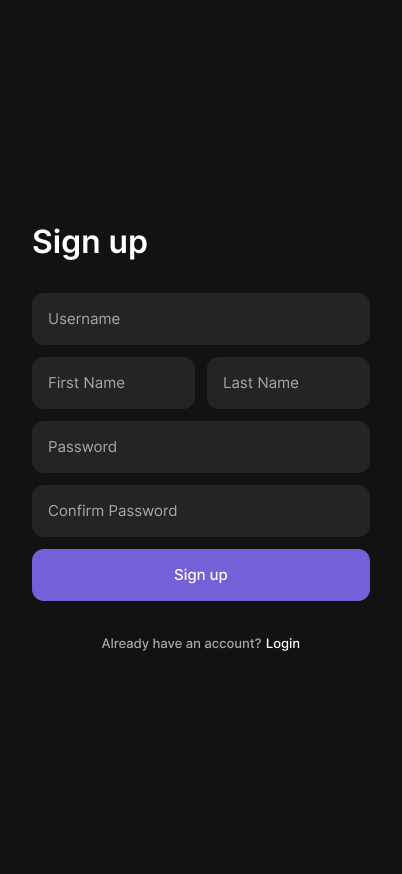
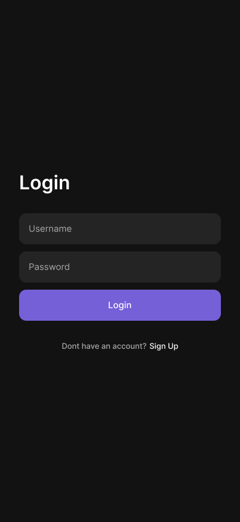
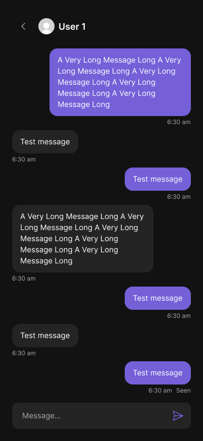
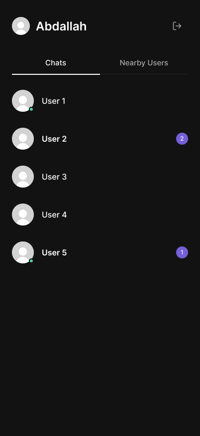
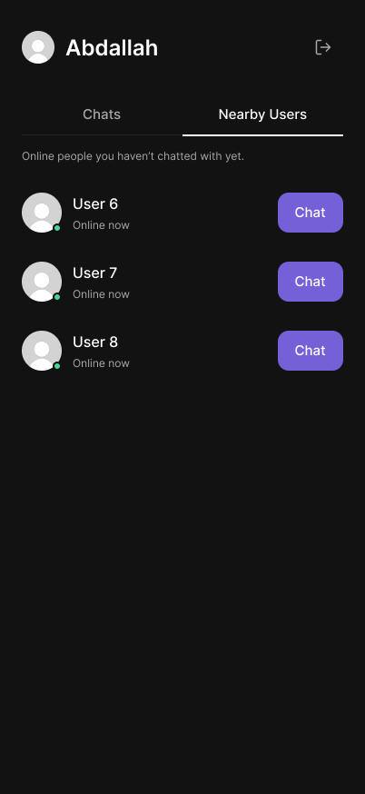
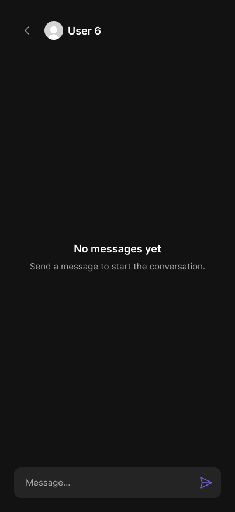

# UI Design

Figma prototype can be found [here](https://www.figma.com/proto/7Tv42DG0xdus2edCGi4ocf/Chat-app?node-id=1-2&t=f8YwhFxBtuIeivMT-1)

#### Colors

| Token        | Color     | Used for                                         |
| ------------ | --------- | ------------------------------------------------ |
| `accent`     | `#7560D8` | Buttons, sent messages, unread badges, send icon |
| `background` | `#121212` | Page backgrounds                                 |
| `surface`    | `#242424` | Inputs, composer, received messages              |
| `text`       | `#FFFFFF` | Primary text and text on accent                  |
| `text-muted` | `#A8A8A8` | Secondary text, placeholders, timestamps         |
| `online`     | `#48D597` | Online indicators                                |

### Screenshots

|              Sign up              |            Login            |
| :-------------------------------: | :-------------------------: |
|        |     |
|           **Chat page**           |        **Home page**        |
|        |  |
|         **Nearby users**          |        **New Chat**         |
|  |    |
